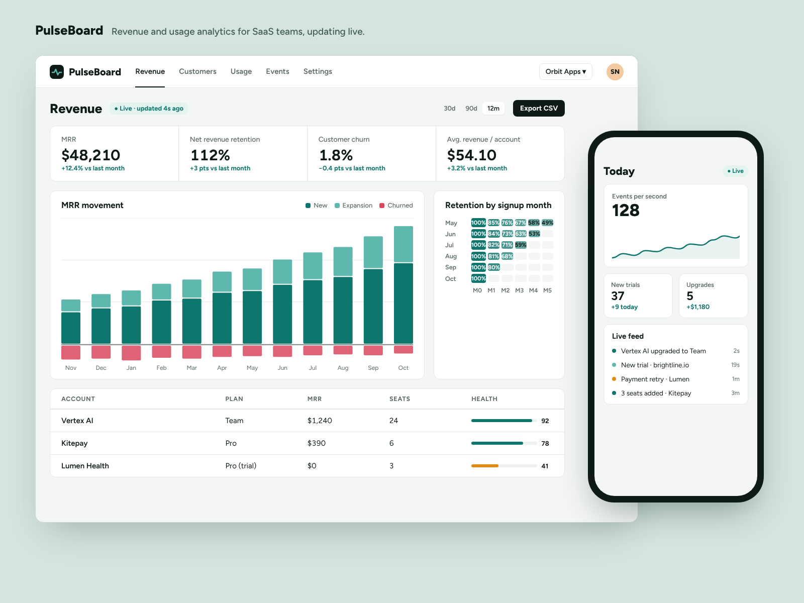
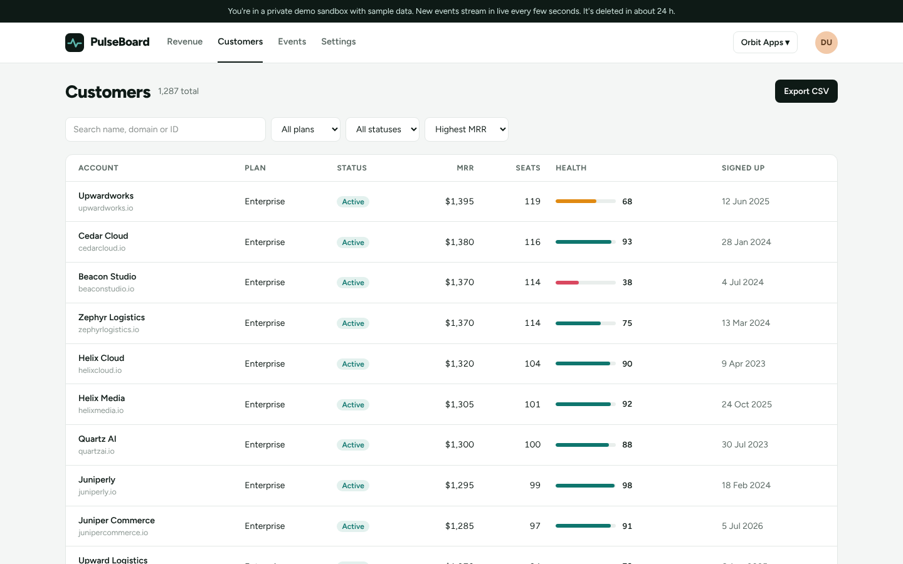
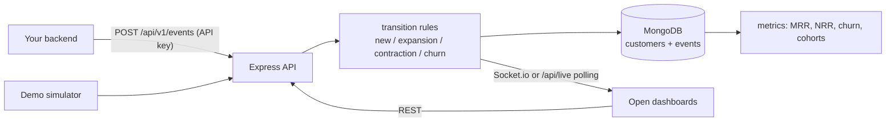

# PulseBoard

Real-time revenue analytics for SaaS teams. MRR, churn, net revenue retention and cohort retention, computed from your subscription events, with a live feed of every signup, upgrade and cancellation as it happens.



**Live demo:** https://pulseboard-demo-gamma.vercel.app

Click **Try the live demo** and you get a private sandbox with two years of realistic data for a made-up SaaS company. While you have it open, new events stream in every few seconds, so the numbers and the feed move. Sandboxes are deleted after 24 hours.

> The hosted demo runs the API as a Vercel serverless function, so the live feed uses short polling there. Run the API as a normal Node server (Docker, Render, a VM) and set `VITE_REALTIME=socket` to get Socket.io push instead. Same events, same UI.

## What it does

- **Revenue dashboard:** MRR, net revenue retention, monthly churn and ARPA, each compared with the previous period. Filter by plan and by 30 days, 90 days or 12 months.
- **MRR movement chart:** new, expansion, contraction and churn per month (or week/day), plus MRR at the end of each period.
- **Retention cohorts:** the share of each month's new customers still paying N months later.
- **Live updates:** every new event and fresh headline numbers reach every open dashboard in the workspace, through Socket.io on a long-running server or through a cursor-based polling endpoint on serverless hosts.
- **Customers:** search, filter by plan and status, sort, paginate, and open a timeline of each customer's events.
- **Events API:** your backend posts six subscription event types with an API key; PulseBoard works out the MRR movement from them.
- **Teams and roles:** owner, admin and viewer, enforced on the server. Invite links, role changes, removal.
- **Billing:** PulseBoard's own plans through Stripe Checkout in test mode, with signed webhooks.
- **CSV export:** the customer list (with current filters) and the MRR movement report.



## How it works



- **One set of rules.** `server/src/domain/apply.ts` has a pure `transition()` function that decides how each event changes a customer and how MRR moved. The live API, the demo-data generator and the simulator all use it, so every number on screen comes from the same logic.
- **Metrics are pure functions** (`server/src/domain/metrics.ts`) over customers and events. At larger scale they'd read from pre-aggregated daily snapshots, but the inputs and outputs would stay the same.
- **Multi-tenant by design.** Every query is scoped by workspace. Membership and role are re-checked on each request (and on socket connect), so removing someone takes effect immediately.
- **Security:** bcrypt passwords, short-lived JWTs, API keys stored as SHA-256 hashes (the full key is shown once), invite tokens hashed, Helmet, CORS allow-list, rate limits on auth, demo creation and ingestion, and formula-safe CSV.

## Tech stack

| Part | Choice |
|---|---|
| Frontend | React 19, TypeScript, Vite, Tailwind CSS 4, Recharts, React Router |
| API | Node.js, Express 5, Socket.io (long-running mode), Zod validation |
| Database | MongoDB with Mongoose (compound indexes per workspace) |
| Billing | Stripe Checkout and webhooks (test mode) |
| Hosting | Vercel (frontend + API as a serverless function), MongoDB Atlas (database). A Dockerfile and `render.yaml` are included for long-running hosts. |

## Events API

```bash
curl -X POST https://<api-host>/api/v1/events \
  -H "Authorization: Bearer pk_..." \
  -H "Content-Type: application/json" \
  -d '{
    "type": "subscription.started",
    "customer": { "id": "cus_42", "name": "Acme" },
    "plan": "pro", "mrr": 99, "seats": 4
  }'
```

| Event | Meaning |
|---|---|
| `customer.signed_up` | A trial starts |
| `subscription.started` | First payment, or a churned customer coming back (reactivation) |
| `subscription.changed` | Plan or seat change; counted as expansion or contraction |
| `subscription.canceled` | Churn |
| `payment.failed` | Account becomes past due |
| `payment.succeeded` | Recovers a past-due account |

Send up to 100 at once as `{ "events": [...] }`. Each result comes back with its own status (HTTP 207 when some fail).

## Run it locally

You need Node.js 20+ and a MongoDB (local, Docker or a free Atlas cluster).

```bash
npm install
cp server/.env.example server/.env      # set MONGODB_URI
cp client/.env.example client/.env
npm run dev -w server                   # API on http://localhost:4000
npm run dev -w client                   # app on http://localhost:5173
```

## Deploy (free)

1. **MongoDB Atlas:** create a free M0 cluster and a database user, allow access from anywhere (`0.0.0.0/0`, since serverless IPs change), and copy the connection string.
2. **API on Vercel (serverless):** import the repo with root directory `server` (Vercel detects Express and uses the app exported from `src/index.ts`). Set `MONGODB_URI`, `JWT_SECRET` and `APP_URL` (your frontend URL). Stripe keys are optional.
   *Or as a long-running server:* the root `Dockerfile` (or `render.yaml`) runs `src/main.ts`, which adds Socket.io, the demo simulator timer and the sandbox sweep.
3. **Frontend on Vercel:** import the repo again with root directory `client` and set `VITE_API_URL` to the API URL. Add `VITE_REALTIME=socket` only when the API is a long-running server.
4. **Stripe (optional):** add a webhook endpoint `https://<api-host>/api/stripe/webhook` for `checkout.session.completed`, `customer.subscription.deleted` and `invoice.payment_failed`, then set `STRIPE_SECRET_KEY` and `STRIPE_WEBHOOK_SECRET`.

## Project structure

```
server/src/
  index.ts              the Express app (default export, used by Vercel), DB connection
  main.ts               long-running server: Socket.io, simulator and cleanup timers
  models.ts             users, workspaces, memberships, invites, customers, events
  auth.ts               JWT, role middleware, hashing helpers
  realtime.ts           socket auth, rooms per workspace, live KPI pushes
  domain/apply.ts       event rules (pure) + persistence
  domain/metrics.ts     MRR, NRR, churn, ARPA, movement, cohorts
  domain/demo.ts        two years of realistic demo history, generated in memory
  domain/simulator.ts   live events for open demo dashboards (timer or on-demand)
  routes/               auth, app (metrics, customers, team), ingest, billing
client/src/
  pages/                Revenue, Customers, Events, Settings, Login, Join
  lib/                  API client, session, live socket hook, formatting
```

## License

MIT
